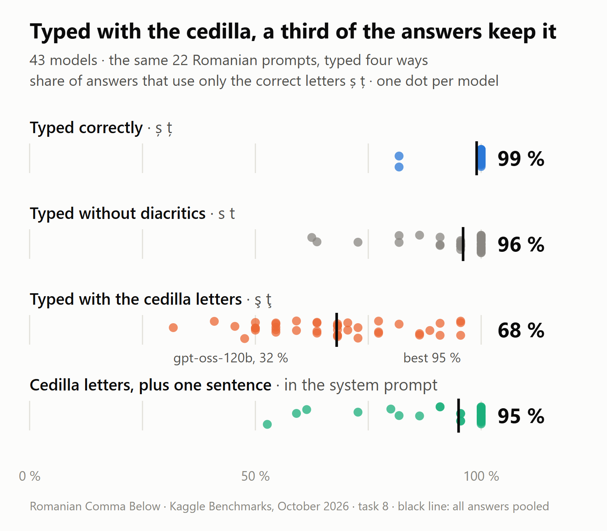

# Comma Below

By Daniel Butnar ([dev.to/danielbutnar](https://dev.to/danielbutnar)). A submission to the DEV and Kaggle
Benchmarking Challenge, October 2026.

A Kaggle benchmark on one Romanian letter pair: **ș ț** (s and t with a comma below, U+0219 / U+021B, the
correct Romanian letters) versus **ş ţ** (s and t with a cedilla, U+015F / U+0163), a legacy encoding
workaround that still fills the Romanian web. The two look almost identical and are different characters.

Thirteen tasks, every score computed from Unicode code points (after NFC). No LLM judge.

- **Benchmark and leaderboard:** https://www.kaggle.com/benchmarks/danielbutnar/romanian-comma-below
- **Write-up:** [Braşov or Brașov? on DEV](https://dev.to/danielbutnar/brasov-or-brasov-15-llms-spell-my-city-right-until-you-spell-it-wrong-first-75a)
  (the address keeps the first version's slug)
- **Current write-up:** `post/post-v3.md` (built into `post/post-v3-dev.md`, the text on DEV, by
  `post/finalize3.py`). Earlier drafts are in `post/archive/`.

## What it found



- **The keyboard echo.** 43 models, the same 22 Romanian prompts typed four ways (task 8): 99 % of the
  answers came back clean when typed correctly, 96 % without diacritics, 68 % with the cedilla. When an
  answer kept all of my cedillas, 95 % of the new ș/ț words the model chose itself had the cedilla too;
  when it kept only some, 10 %.
- **Only the cedilla echoes.** On 28 models (task 13), 38 % of the cedilla letters came back, against
  0.9 % for a dot below (Braṣov) and 1.4 % for old mojibake (Braºov).
- **One sentence fixes most of it, and breaks Turkish.** A system-prompt rule lifts cedilla input to 95 %
  clean (task 8). On 14 models it drops correct Turkish replies, where ş is right, from 100 % to 71 %;
  scoped to Romanian, 95 % (task 10).

The numbers come from `results/post_values.json`, which `analysis/check_claims.py --values` writes.

## Tasks

| # | Task | Question | Items |
| --- | --- | --- | --- |
| 1 | Write | From English prompts (ASCII place names), does the model write ș/ț correctly? | 24 |
| 2 | Echo | When the user's text is typed with cedilla, does the reply, summary or retrieval answer copy it? Paired with a clean control. | 44 |
| 3 | Fix | Asked to proofread cedilla text (plain → explicit instruction), does it repair the letters? | 18 |
| 4 | See | Can it tell ş from ș? Same/different, detection, code point. | 36 |
| 5 | Restore | Put diacritics back into ASCII Romanian where context decides (peste/pește). | 30 |
| 6 | Code | Write `fix_romanian(text)`; 14 hidden tests. | 2 |
| 7 | Echo with a rule | Echo's cedilla inputs again, with one system-prompt sentence asking for comma-below letters. | 22 |
| 8 | Echo, four inputs | Echo's 22 prompts typed clean, with cedilla, without diacritics, and with cedilla + the rule; every model Kaggle serves. | 88 |
| 9 | Contagion | Four documents and a question about one; 0, 1 or 3 of the others typed with cedilla, or the target. | 40 |
| 10 | Turkish guests | Turkish (where ş is correct) under no rule, task 7's rule, and the same rule scoped to Romanian. | 36 |
| 11 | Other look-alikes | English text typed with Cyrillic look-alike letters (in every word, or only in the names) or as mojibake (Zürich). | 48 |
| 12 | Turns | Two summaries in one chat: does a cedilla first text infect the second? | 18 |
| 13 | Other wrong letters | Task 8's summaries and document questions typed with a dot below (Braṣov) or old Windows-1250 mojibake (Braºov) instead of the cedilla, and with the scoped and the full rule. | 80 |

Tasks 8–13 (Round 2) carry predictions written before their first run. They are in the first cell of each
task's notebook on Kaggle, and the task's version history there shows when each version was pushed. This
repository can't show the order: Round 2 was committed in one go on 10 October. Tasks 10 and 11 had a pilot
run on one model (Gemini 3.7 Flash) and a second version after it: task 10 stopped counting ș inside
Romanian place names, task 11 added look-alikes confined to the names. The predictions didn't change. The
text for each task page, with notes added after the runs, is in `post/kaggle-task-descriptions.md`.

Also here:

- **A two-minute human test** on task 4's word pairs: https://danielbutnar.github.io/comma-below/human/test.html
  (`human/test.html`; Romanian, German, English). The page sends nothing and stores nothing. At the end it
  shows a short code (score, device type, screen size, time taken) that people can send me or, from the
  DEV link, post in a comment, where it is public. The codes stay on my laptop (`human/results.txt`, not in
  the repository); `analysis/human_summary.py` turns them into `results/human_summary.json`, the only human
  results published. Version 1 (until 10 Oct) marked the words as Romanian, and on a Romanian page fonts
  such as Segoe UI, Roboto, Noto Sans and Open Sans draw ş with a comma, so many people saw two identical
  words; version 2 marks them as English and scores identical and different pairs separately. The two
  versions are summarised apart.
- **A cedilla checker** for any text (`post/checker.html`, also at
  https://danielbutnar.github.io/comma-below/post/checker.html), embedded in the write-up. Its fix is the
  post's `fix_romanian()`: it swaps ş ţ for ș ț sentence by sentence; in a sentence with ı ğ ç ö ü it swaps
  only ţ (Turkish has no ţ) and leaves ş alone. A Turkish sentence without those letters ("Hoş geldiniz!")
  still gets changed, and a Romanian sentence quoting Zürich keeps its ş (the checker says so).
  `analysis/fix_check.py` measures it on the models' Turkish and Romanian answers.

## Layout

- `src/items.py`: all items. Romanian is written in correct orthography; cedilla, ASCII, Cyrillic and mojibake
  variants are generated, never typed.
- `src/scoring.py`: scoring helpers, pasted into every task.
- `src/build.py`: renders `tasks/*.py`. The task files are ASCII-only (`\u` escapes) and check a SHA-256 of their data
  before running, because the Kaggle CLI reads task files with the locale encoding (cp1250 here) and would push
  "BraČ™ov" instead of "Brașov". Rebuilding gives the same files byte for byte.
- `src/dry_run.py`: runs the tasks locally against fake models with known behaviour and asserts the expected
  scores: seven on tasks 1–7 (perfect, cedilla, stripped, mirroring, flaky, picky, thinking), nine on tasks 8–12
  (plus sticky and normalizing) and ten on task 13 (plus a mojibake reader). The fake models answer in the format
  the prompt asks for, so they don't test how the parsers read wordy answers (see Known issues).
  `python src/dry_run.py -8- -9-` runs a subset.
- `analysis/`: `web_census.py` (cedilla use on Romanian front pages, 30 September) and `web_lang.py` (which of
  them mark their pages as Romanian, fetched 10 October); `analyze.py` loads the runs; `post_stats.py` (Round 1)
  and `round2.py` (Round 2, with bootstrap intervals, McNemar tests and version trends); `task13.py` (the analysis
  pre-registered in task 13); `own_words.py` (do the model's own words follow a copied cedilla?); `fix_check.py`;
  `human_summary.py` (needs the private `human/results.txt`, so it fails in a fresh clone); `models.py` (labs,
  product lines, versions); `charts.py`, `charts2.py`, `charts3.py` write the charts as HTML into `post/`;
  `check_claims.py` recomputes the numbers the post quotes and scores the predictions; cost and quota scripts.
- `results/`: every scored answer as Kaggle returned it (`results/raw/<task>/<version>/<model>/<run>/*.jsonl`, the
  rows the analysis reads). Older task versions are pilots and reruns; the analysis keeps the newest version. The
  run traces (`*.run.json`, about 90 MB) are not in the repository. Also per-item tables (`items.csv`,
  `items_round2.csv`), per-model summaries, Round 2 tables, Echo runs, and `post_values.json`, the numbers the
  write-up quotes.
- `post/`: the write-up and what it uses. `post-v3.md` is the source, with `{{KEY}}` placeholders;
  `finalize3.py` fills them from `results/post_values.json` and writes `post-v3-dev.md`, the text pasted into DEV.
  `build_checker_tag.py` turns `checker.html` into the DEV embed (`checker-tag.txt`). `node post/render.mjs
  post/<chart>.html` renders a chart or the cover to PNG (needs `playwright-core` and Chrome). Kaggle texts:
  `kaggle-description-v2.md` (the benchmark) and `kaggle-task-descriptions.md` (each task, written by
  `task_descriptions.py`). Some charts here aren't in the current write-up: `cover.png`, `chart-echo.png`, `chart-see.png`
  and `chart-web-census.png` were in the first version on DEV and stay where it linked them. Earlier drafts:
  `post/archive/`.
- `docs/next-version.md`: the fixes for the next task version, as patches. `PUBLISH.md`: how the write-up and the
  Kaggle texts get published.

## Run

```bash
uv run --no-project --with pandas python src/build.py
uv run --no-project --with pandas --with kaggle-benchmarks==0.6.1 python src/dry_run.py
# pushing and running need the kaggle CLI (2.2.4) and a Kaggle account
PYTHONUTF8=1 kaggle b t push romanian-comma-below-1-write -f tasks/romanian-comma-below-1-write.py --wait
PYTHONUTF8=1 kaggle b t run romanian-comma-below-1-write -m gemini-3.8-flash
PYTHONUTF8=1 kaggle b t download romanian-comma-below-8-echo-four-inputs -o results/raw   # optional: the answers are committed
uv run --no-project --with pandas --with numpy python analysis/round2.py
uv run --no-project --with pandas --with numpy python analysis/check_claims.py
```

Two of the write-up's numbers need the run traces, which are not in the repository: what DeepSeek-R1's
reasoning says about the letters, and the cost. Without the traces, `check_claims.py --values` keeps the
committed values for those; everything else recomputes from the committed answers.

## Known issues in the pushed tasks

The task files stay as they ran, so the code here matches the leaderboard. What each issue changes:

- **See takes the first match.** Task 4 scores the first true/false or U+XXXX in an answer. DeepSeek-R1 listed
  every letter's code point before the right one, so it shows 83 % with all 36 answers right; Gemini 3.5
  Flash-Lite shows 83 % with 32 of 36 right. No other model changes.
- **An empty answer counts as a failure, and a run with no completed item scores 0.** Qwen 3 Next 80B Thinking
  used up the 8,192-token cap on 11 of its 22 cedilla prompts in task 8 and shows 45 %; 10 of the 11 answers it
  finished were clean. Grok 4.5 and 4.6 show 0 % (every call returned 404), and so does gpt-oss-120b's latest
  Code run (both prompts hit rate limits). The Round 2 analysis leaves empty answers out (`ok_rows()` in
  `analysis/round2.py`).
- **Errored items drop out of a run's denominator.** Gemini 3.7 Flash's task 7 score covers 16 of 22 prompts (its
  six guest replies hit rate limits). gpt-oss-120b's first-round scores rest on as few as 7 of 36 items (See).
- **Task 10's name list is older than the write-up's.** The task leaves Romanian place names out of the Turkish
  count; the write-up also leaves out village names (Bunești, Sâmbureștii) and dishes (papanași). 4 of 336
  Turkish replies fail on Kaggle and count as correct in the write-up: full rule 67.9 % against 70.5 %, scoped
  rule 93.8 % against 94.6 %.
- **Task 6 runs the model's code with the full environment**, including the model proxy's credentials, and code
  that prints without a final newline would make the item error instead of scoring it. No item in the data was
  affected.
- **Texts.** The one-line descriptions of tasks 5 and 6 lost their letters to ASCII ("peste/peste", "French c").
  Task 11's scoring line describes a rule per input; the code applies one rule to every answer, with the same
  result on every stored answer. Task 13's text says "Brașov becomes Braºov"; precisely, the cedilla spelling
  Braşov becomes Braºov (Windows-1250 has no ș). `post/kaggle-task-descriptions.md` adds a note for each.

The fixes, as patches against `src/` and tested with the dry run but not applied, are in
[docs/next-version.md](docs/next-version.md).

## Credits

The tasks run on Kaggle's [kaggle-benchmarks](https://pypi.org/project/kaggle-benchmarks/) library. The checker
is embedded in the write-up with [LiveCodes](https://livecodes.io). The charts and cover are rendered with
[Playwright](https://playwright.dev); the cover uses the Source Serif 4 and IBM Plex Mono fonts (SIL Open Font
License).

I'm a native Romanian speaker and checked the answer keys myself. The Turkish and English texts of tasks 10 and
11 were not checked by native speakers; only the letters under test are scored.

License: MIT.
